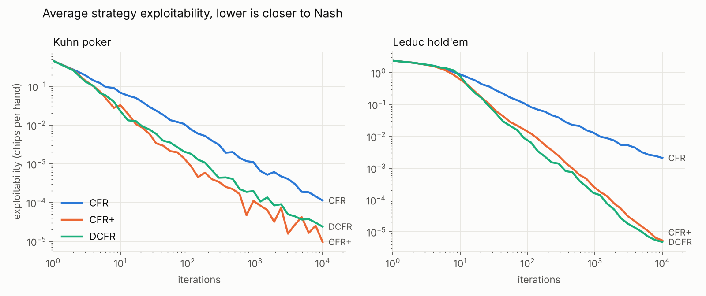
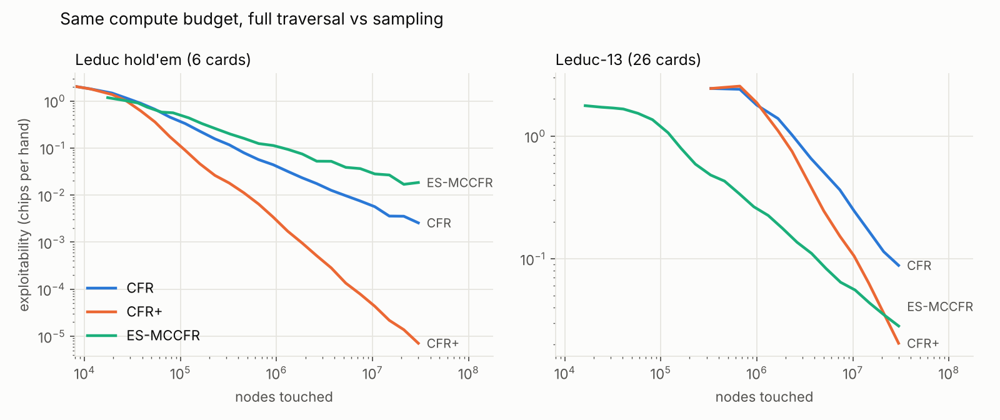
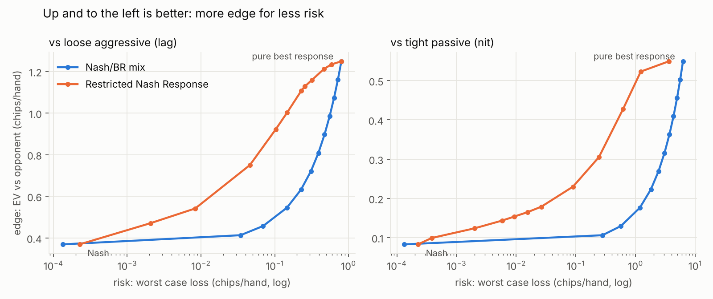
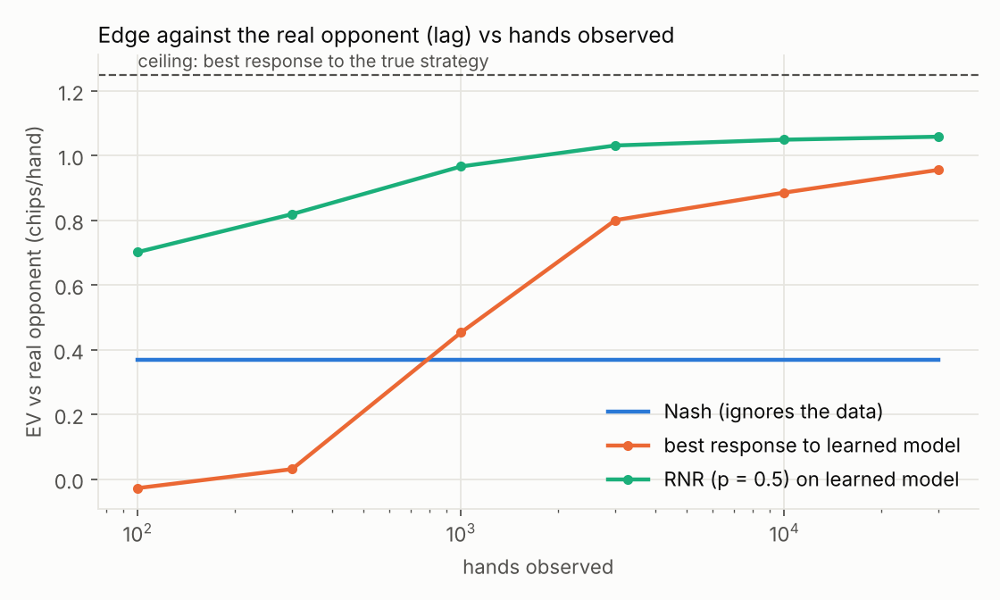
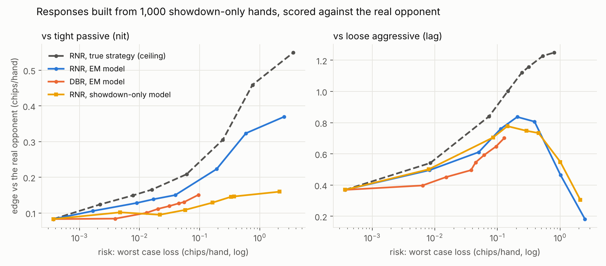
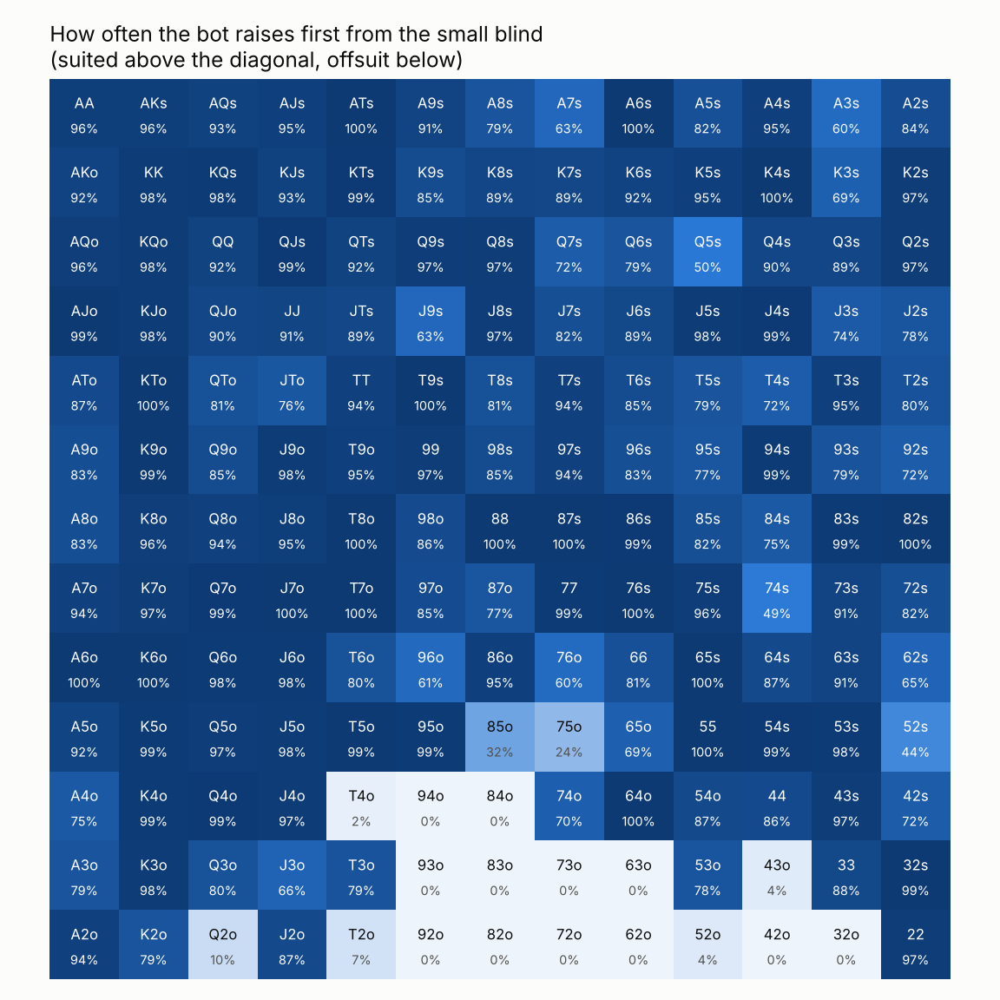

# poker-cfr

Game theory poker bots built around counterfactual regret minimization (CFR), from toy games solved exactly up to a heads up no-limit Texas hold'em bot. The project covers four things:

1. **Solving.** CFR, CFR+ and Discounted CFR on vectorized numpy tree passes, plus external sampling Monte Carlo CFR for trees too big to walk every iteration. Leduc is solved to within 5 millionths of a chip per hand of Nash in under 4 seconds.
2. **Measuring.** Exact best responses and exploitability, so every claim about strategy quality is checked rather than estimated. Sampled matches show how noisy poker results are and how duplicate dealing helps.
3. **Exploiting.** Restricted Nash Response and Data-Biased Response, which win more from weak opponents while capping how much a strong one could take back. Opponents are learned from realistic showdown-only hand histories with EM. It is the poker version of sizing an edge against model risk.
4. **No-limit hold'em.** A heads up no-limit bot in Slumbot's format (200 big blinds), with card and bet-size abstraction, Monte Carlo CFR compiled with numba (1.2 billion iterations in 90 minutes on two CPU cores), action translation for any bet size, real-time search on the river and a client to play it against Slumbot.

You can also play the bot in a browser: open `docs/index.html`, or turn on GitHub Pages for the `docs` folder.



## Results at a glance

| | |
|---|---|
| Leduc solved by CFR+ | exploitability 5.3e-06 chips/hand after 10,000 iterations, 3.6s |
| Leduc game value (first player) | -0.08561, matches the published value |
| ES-MCCFR on 13 rank Leduc | 7x less exploitable than CFR+ at 1M nodes touched |
| Restricted Nash Response vs a loose aggressive bot | 2x Nash's edge for 1/7 of the risk naive mixing needs |
| Learning an opponent from 100 hands | best response to the model loses money, RNR nearly doubles Nash's edge |
| Showdown-only histories | naive counting thinks a nit folds a J 5% of the time (true 85%), EM recovers 81% |
| No-limit hold'em bot vs a straightforward equity-based player | +74 bb/100 over 100,000 duplicate hands (95% CI +59 to +89) |
| Real-time river search vs the plain bot | +45 bb/100 over 12,000 paired hands (95% CI +24 to +66) |
| No-limit hold'em bot vs Slumbot | -1.8 bb/100 over 18,000 hands (95% CI -24.6 to +21.1) |
| Exploitability lower bound (Local Best Response) | 1,209 mbb/hand over 32,000 hands, Slumbot 2016 measured 4,020 the same way |

## 1. Solving

### Three full traversal solvers

All three share one loop. Each iteration does a pass per player: build the current strategy from regrets, push reach probabilities down the tree, pull values back up, then credit each action with how much better it would have done than the strategy actually played, weighted by how likely chance and the opponent were to get there. The average strategy across iterations is what converges to Nash.

- **CFR** (Zinkevich et al. 2007): plain regret matching, uniform averaging.
- **CFR+** (Tammelin 2014): regrets floored at zero, later iterations weighted more.
- **DCFR** (Brown and Sandholm 2019): old positive regrets shrink a little each round, negative ones halve.

The tree is flattened into numpy arrays in breadth first order, so each depth level is one contiguous slice and an iteration is a handful of array operations per level. A full Leduc iteration takes about 0.35 ms. Leduc-13 (166,349 nodes) takes about 10 ms.

| game | algorithm | exploitability @ 10,000 iters | game value (first player) | time |
|---|---|---|---|---|
| Kuhn | CFR | 1.13e-04 | -0.05556 | 1.1s |
| Kuhn | CFR+ | 9.63e-06 | -0.05556 | 1.1s |
| Kuhn | DCFR | 2.39e-05 | -0.05556 | 1.3s |
| Leduc | CFR | 2.09e-03 | -0.08579 | 3.5s |
| Leduc | CFR+ | 5.35e-06 | -0.08561 | 3.6s |
| Leduc | DCFR | 4.81e-06 | -0.08561 | 3.9s |

### Monte Carlo CFR for bigger trees

Full CFR touches every node on every iteration. Heads up limit hold'em has around 10^14 decision points, so that stops being an option. External sampling MCCFR (Lanctot et al. 2009) follows one sampled path for chance and the opponent while still trying every action of the player being updated. Iterations are tiny and noisy but the average still converges.

To give it something to do, Leduc is generalized to more ranks. Leduc-13 uses 26 cards (13 ranks, 2 suits), which grows the tree from 1,939 nodes to 166,349. Both methods are charged for every node they visit, since wall time would just compare numpy to plain Python.



| game | algorithm | 1e5 nodes | 1e6 nodes | 1e7 nodes | 3e7 nodes |
|---|---|---|---|---|---|
| Leduc | CFR+ | 0.174 | 0.003 | 0.000 | 0.000 |
| Leduc | ES-MCCFR | 0.559 | 0.113 | 0.037 | 0.018 |
| Leduc-13 | CFR+ | no full iteration yet | 1.869 | 0.105 | 0.020 |
| Leduc-13 | ES-MCCFR | 1.358 | 0.265 | 0.064 | 0.028 |

On classic Leduc the tree is so small that full CFR+ wins everywhere. On Leduc-13 sampling is about 7x better at a million nodes and CFR+ only catches up around 2 x 10^7. The bigger the tree, the further right that crossover moves, which is why large poker bots rely on sampling.

## 2. Measuring

### How I know it's correct

Every number is checked against values from outside this code:

- **Kuhn game value** is -1/18 for the first player. Matches.
- **Leduc game value** is about -0.0856 for the first player. Matches to 5 decimals.
- **Uniform random NashConv** is 11/12 for Kuhn and 4.747222 for Leduc, the figures OpenSpiel's own tests use. Both match to machine precision.
- **The Kuhn strategy** lands on the known equilibrium family: bluff a Jack with probability a, bet a King with 3a, call with a Queen 1/3 of the time. The solver found a = 0.2226 with the King at 0.668.

Leduc has 288 information sets here because suits never matter in it. Papers that count suits separately report 936.

### Why sampled results lie to you

Exploitability is exact here because the games are small. In real games you have to play hands and measure. Poker is noisy. Against an always calling bot the true edge is +0.633 chips/hand. 40,000 hands with normal dealing gave a 95% interval of +0.627 to +0.701. Duplicate dealing, where every deal is replayed with the bot in both seats holding both hands, gave +0.614 to +0.655 from the same 40,000 hands. That is a 1.8x smaller standard error, worth about 3.3x more hands.

Against a bot that randomizes heavily duplicate barely helps, since most of the noise then comes from both players' actions rather than the cards. Methods like AIVAT go after that part.

## 3. Exploiting

A Nash strategy never loses on average, but it also leaves money on the table against bad players. The best response to an opponent wins the most against that opponent and can get destroyed if your read is wrong. So the real question is how much edge you can get for a given amount of risk.

- **Risk** = how much a perfect opponent could win from you per hand (your exploitability).
- **Edge** = your EV per hand against the opponent you're targeting.

Two human-like opponents are included: a **nit** (tight passive, folds too much) and a **lag** (loose aggressive, bluffs and raises too much). Both play randomized strategies.

### Restricted Nash Response vs naive mixing

The obvious approach is to play Nash some of the time and the best response the rest. Restricted Nash Response (Johanson, Zinkevich and Bowling 2007) is smarter: solve a modified game where, with probability p, the opponent is forced to play your model. Otherwise it is free to punish you. Sweeping p from 0 to 1 gives strategies that get the most edge for each level of risk.



- **vs lag:** RNR at p = 0.2 gets +0.750 per hand, about double Nash's +0.369, while a perfect opponent could only take 0.046 back. Mixing needs 0.31 of risk for the same edge, almost 7x more.
- **vs nit:** RNR at p = 0.5 gets +0.179, about double Nash's +0.083, at risk 0.026. Mixing needs about 1.18 for that edge, around 45x more. The pure best response against the nit is so lopsided it can be exploited for over 6 chips per hand.

Mixing has to be done before the hand starts, not infoset by infoset, or it is a different strategy entirely. The code mixes in sequence form and converts back.

### Learning the opponent from hand histories

In practice you don't know the opponent's strategy. Here the bot watches N hands of the lag, estimates its strategy (falling back to equilibrium play where it has little data), then compares three ways to respond. Numbers are EV against the real lag, averaged over 3 seeds.



| hands watched | best response to model | its risk | RNR p = 0.5 | its risk |
|---|---|---|---|---|
| 100 | -0.028 | 3.12 | +0.702 | 0.15 |
| 1,000 | +0.453 | 2.31 | +0.967 | 0.19 |
| 30,000 | +0.956 | 1.19 | +1.058 | 0.20 |

Nash gets +0.369 without looking at any data and the ceiling (best response to the true strategy) is +1.249. After 100 hands the naive best response actually loses money, because it overfits a noisy model. RNR on the same data already gets nearly double Nash's edge and keeps its risk small throughout. That's the same overfitting problem you see when a trading model is fit on too little data.

That experiment cheats a little: it assumes you see the opponent's card after every hand. The next one doesn't.

### Realistic histories: selection bias and EM

In a real game you only see the opponent's card when the hand reaches showdown. Against the nit that's 47% of hands. The obvious fix is to learn only from showdown hands, but a hand where the opponent folded never reaches showdown, so that data has almost no folds in it. A naive model ends up thinking a tight player is a calling station.

The fix is expectation maximization with the hidden card as a latent variable. For each hand without a showdown, work out how likely each possible card was given what the opponent did (using the current model and the cards already accounted for), add fractional counts in that proportion, refit and repeat. The E step keeps a little uniform mass, otherwise a model that once says "never folds a Q" could never assign a fold to a Q again.

Fold frequency the nit model learns from 3,000 hands:

| spot | true | full histories | showdown hands only | EM |
|---|---|---|---|---|
| J facing a bet, first round | 0.85 | 0.86 | 0.05 | 0.81 |
| Q facing a bet, first round | 0.20 | 0.23 | 0.00 | 0.24 |
| J facing a bet after checking | 0.85 | 0.87 | 0.07 | 0.85 |
| Q facing a bet after checking | 0.20 | 0.20 | 0.00 | 0.17 |

Best responding to those models against the real nit: full histories earn +0.442 per hand, showdown-only +0.233 and EM +0.459. EM recovers all of the edge the selection bias cost. Against the lag, which folds less so the bias matters less, EM still beats naive counting from 3,000 hands up (+0.732 vs +0.630), but at 1,000 hands or fewer every model is too noisy for a best response to be trusted either way.

### How much to trust the model: RNR vs Data-Biased Response

RNR uses one trust level p for the whole game. Data-Biased Response (Johanson and Bowling 2009) sets it per spot instead: at every opponent decision there is a coin flip that pins them to the model with probability p_max x n / (n + 20), where n is how many times that spot showed up in the data. Spots with lots of data get trusted, spots seen twice get almost none.

Below, both are built from an EM model learned from 1,000 showdown-only hands and scored against the real opponent. The dashed line is RNR given the true strategy, which is the best you could hope for.



- **Tuned well, RNR gets more edge per unit of risk.** Against the lag, RNR at p = 0.4 reaches +0.761 at risk 0.113. DBR's best point is +0.701 at risk 0.129.
- **Pushed too far, RNR falls off a cliff.** Past p = 0.55 it starts trusting the model's mistakes. At p = 1 it earns only +0.182 against the real lag, half of what Nash gets, while being exploitable for 2.5 chips per hand.
- **DBR can't be overdone.** Its edge rises steadily across the whole range of p_max and its worst case risk never goes above 0.13 against either opponent.

You can only tune RNR's p well if you can check results against the real opponent, which is exactly what you can't do in practice. That makes DBR the safer default, at the cost of some edge when the model is good. The same trade-off shows up anywhere you size positions off a fitted model.

## 4. No-limit hold'em

Kuhn and Leduc are small enough to solve exactly. Heads up no-limit Texas hold'em has around 10^160 decision points, so the bot plays a simplified version of the game and gets judged by how it does against opponents rather than by exact exploitability. The setup follows Slumbot's format so the bot can be tested against it: 20,000 chip stacks and blinds of 50/100.

### How it's built

- **Hand evaluator.** A 7 card evaluator compiled with numba, about 50 ns per hand. It's checked against a slow brute force evaluator on thousands of random hands.
- **Card abstraction.** Preflop uses the 169 strategically different starting hands. On the flop and turn hands are grouped into 50 buckets by equity against a random hand with the rest of the board dealt out, which counts draws. The river uses exact strength against every possible opponent hand. Buckets are equity percentiles so each holds about the same share of hands.
- **Deal pool.** Computing equity is the expensive part, so 2 million deals are precomputed once (about 12 minutes). Training then draws from the pool, which makes each iteration a pure tree walk.
- **Bet-size abstraction.** Preflop opens to 2.5 or 4 big blinds, two 3-bet sizes, one 4-bet size. Postflop bets of a third, three quarters and 1.25x pot, one raise size. All-in is always an option. That gives 35,000 decision points and 1.75 million strategy rows.
- **Training.** External sampling MCCFR in numba, two threads sharing the regret tables without locks. Linear discounting for the first 30% of training, then negative regret pruning (the two speedups used by Libratus and Pluribus). Pruning took it from about 19,000 to over 300,000 iterations per second. 1.2 billion iterations took 90 minutes.
- **Action translation.** When an opponent bets a size the bot doesn't know, the bet is mapped randomly onto the two nearest sizes with the pseudo-harmonic mapping (Ganzfried and Sandholm 2013). A bet that puts most of a stack in is treated as a shove. If a hand leaves the abstract tree completely, the bot falls back to a pot odds rule. That happens in 0.1% of decisions against a normal opponent and about 3% against a random bettor.

### Results

Duplicate matches, 100,000 hands per opponent:

| opponent | bot result | 95% interval | bot left its tree |
|---|---|---|---|
| calling station (never bets, never folds) | +198 bb/100 | +187 to +209 | 0.0% of decisions |
| maniac (pot-size raises whenever possible) | +313 bb/100 | +272 to +354 | 0.8% |
| random bettor | +190 bb/100 | +159 to +221 | 2.8% |
| equity bot (bets strong hands, calls with the right price, never bluffs) | +74 bb/100 | +59 to +89 | 0.1% |

The equity bot is the meaningful one. It plays a simple, predictable game that never bluffs and the CFR bot beats it by about 3/4 of a big blind per hand. The other three are sanity checks.



The small blind opening strategy came out of nothing but self-play. Weighted by how often each hand is dealt it raises 75% of hands, limps 13% and folds 13%. The folds are the worst offsuit hands. It's also visibly noisy. T3o raises 79% of the time while T4o raises 2%. A few suited hands sit oddly low too. A fully converged solver gives smooth ranges, so this is the clearest sign of what 90 minutes on two CPU cores doesn't buy.

### Upgrade attempt: distribution-aware buckets

Equity buckets put a flush draw and a weak made hand with the same equity in the same bucket, even though they play very differently. The standard fix (Johanson et al. 2013) is to bucket by the whole distribution of where a hand's strength could end up. For every deal in the pool, each player's flop and turn hand gets a 20-bin histogram of its river strength over 40 sampled runouts. Those histograms are clustered with k-means into 50 buckets per street. Histograms are compared by their cumulative sums: for one dimensional histograms the earth mover's distance is the L1 distance between CDFs and L2 is a close stand-in. The river keeps exact strength. On the nut flush draw `AhKh` on `7h2h9c` the histogram puts most of its mass near 0 and near 1, while top pair with a weak kicker sits in the middle. Equity buckets can't see that difference.

The new bot was trained with the same bet sizes, deals and 90 minute budget, then measured head to head against the old one and against the same baselines:

| | equity buckets (old) | histogram buckets (new) |
|---|---|---|
| vs calling station | +198 bb/100 | +205 bb/100 |
| vs maniac | +313 | +343 |
| vs random bettor | +190 | +127 |
| vs equity bot | +74 (+59 to +89) | +72 (+56 to +88) |
| new vs old, 500,000 duplicate hands | | +3 bb/100 (95% CI -1 to +7) |

**It didn't measurably help.** Head to head the new bot is ahead by about 3 bb/100 but the interval still includes zero after half a million hands. Against the equity bot the two are identical. Against the random bettor the new one is clearly worse. Likely reasons:

- **Noisy histograms.** Each runout's river strength comes from 40 random opponent hands, so two identical hands can land in different buckets. Hands with flop equity between 0.55 and 0.57 ended up spread over 34 of the 50 buckets. Part of that spread is sampling noise rather than real differences.
- **Too few buckets to spend the extra detail.** With 50 buckets the clusters have to cover both strength and shape, so each one ends up wide on both.
- **Opponents that don't care.** None of the baselines play differently against draws, so a bot that understands draws better has little extra to gain from them. The difference should show up more against a strong opponent like Slumbot, which is where measurement is hardest.

The fix would be exact or much finer histograms and more buckets, which costs more precomputation and training. For now `models/holdem_bot.npz` stays the default and the histogram bot is kept as `models/holdem_bot_dist.npz` for comparison.

### Real-time search on the river

The blueprint plays from a lookup table: one answer per bucket, with every real bet squeezed onto the nearest abstract size. Libratus and Pluribus both went further by solving the rest of the hand during play. This bot does that on the river:

1. **Ranges.** Every two card combo that fits the board (1,081 of them) gets a weight for each player: how likely that hand was to make every move seen so far, under the blueprint. Each past move multiplies in the blueprint's probability for that hand's bucket. Once the bot has searched on the river, its own earlier river moves use the solved strategy instead.
2. **Subgame.** A betting tree from the current spot with the real pot, real stacks and real bet sizes, plus a richer menu of sizes from here on (a third, three quarters, 1.25x and 2x pot, then raises). No buckets and no translation: every hand is its own row.
3. **Solve.** Vector CFR+ over all hands at once, 200 iterations, about a second. Showdown values use the sorted-strength trick with card removal (each terminal costs O(hands) rather than O(hands²)), checked against brute force. 200 iterations gets within about 0.6% of the pot of a perfect river strategy.

This is "unsafe" re-solving as in Pluribus: the ranges assume the opponent played like the blueprint. Libratus added a gadget that guarantees the re-solved strategy can't be more exploitable than the blueprint. That is the main thing left out.

**Measuring it.** A paired comparison: every hand is played twice, once by the plain blueprint bot and once by the searching bot, with the same cards and the same random numbers. Both play identically until the river, so the difference isolates exactly what search changes. Comparing the blueprint with itself this way gives exactly zero, which checks the pairing.

| opponent | search minus blueprint | 95% interval | paired hands |
|---|---|---|---|
| the blueprint bot | **+45 bb/100** | +24 to +66 | 12,000 |
| equity bot | +17 bb/100 | -26 to +60 | 10,000 |

Against the blueprint the gain is clear. Against the equity bot it points the same way but the interval still includes zero. River pots against that opponent are bigger and swingier. That run was also stopped after 10,000 of the planned 12,000 hands. The likely reason for the gap is that search helps most where the blueprint's own river play was weakest: off-tree bet sizes and spots where 50 buckets lumped very different hands together. Against the blueprint those spots come up all the time. The equity bot never bluffs, so a better bluff catcher gains less against it.

### Upgrade attempt: turn search

The natural next step after river search is searching on the turn too, which is what Libratus did. On a turn decision the bot solves the rest of the hand: turn betting from the real spot, every river card that can come and river betting after each one. That makes the tree far bigger than the river alone (one river subtree per card), so this solver is compiled with numba:

- **One betting tree, per-card river regrets.** The betting doesn't depend on the cards, so the tree is built once. River decisions keep separate regrets for each river card, since a hand plays a river that made a flush differently from one that paired the board.
- **Sampled river cards.** Each iteration walks through 4 of the 48 unseen cards, cycling through the deck so every card gets the same number of visits. A combo holding the sampled card is dropped for that card. A pair of hands that don't clash keeps each card with probability 44/48, so river values are scaled by 48/44 to stay unbiased next to the turn fold payoffs. With all 48 cards the values match a brute force calculation exactly.
- **A coarse river inside the turn solve.** The river part only offers a 3/4 pot bet and all-in to keep the tree small. When the river actually comes, the river search solves it again with the full menu.

200 iterations take about 2 seconds per turn decision. On 6 real turn spots this gives up 2.7 chips per decision on average compared with an exact 400 iteration solve over all 48 river cards, so solver accuracy is not the limit.

Measured the same paired way, turn plus river search against river search alone, both playing the blueprint:

| | result | 95% interval | paired hands |
|---|---|---|---|
| turn search minus river search | -8.9 bb/100 | -34.6 to +16.7 | 12,000 |

**No measurable gain.** The four 3,000 hand chunks came out at -44, +8, +7 and -7, which is what a true effect near zero looks like. River search stays the default. Likely reasons:

- **The river search already fixes most of the damage.** River decisions are where a translated bet size or a coarse bucket costs the most. Those are already re-solved. The blueprint's turn play is less broken to begin with.
- **The turn solve plans for a river the bot doesn't play.** It values each turn line assuming a coarse river (one bet size plus all-in), then plays the real river with four sizes. That gap makes some turn values wrong in a consistent direction.
- **Unsafe re-solving.** Both turn and river search assume the opponent played like the blueprint and will play an equilibrium from here. Against an opponent that is the blueprint, the second half of that assumption is wrong on every street the bot searches.

### Against Slumbot

Slumbot is one of the strongest public heads up no-limit bots, trained for far longer on far bigger hardware. `holdem_slumbot.py` plays this bot against it through Slumbot's public API (it needs internet access).

The blueprint bot without search, in two separate runs:

| run | hands | result | 95% interval | network retries | hands abandoned | bot left its tree |
|---|---|---|---|---|---|---|
| 1 | 8,000 | -11.7 bb/100 | -44.8 to +21.4 | 17 | 0 | 5 of 21,135 decisions |
| 2 | 10,000 | +6.1 bb/100 | -25.3 to +37.6 | 30 | 0 | 6 of 26,553 decisions |
| both | 18,000 | **-1.8 bb/100** | -24.6 to +21.1 | | | |

The interval includes zero, so after 18,000 hands this bot can't be told apart from break-even against Slumbot. It can't be said to beat it either: the true result could be a loss of up to about 25 bb/100. Going in, a loss under 100 bb/100 looked like a decent outcome for 90 minutes of training on two cores. The two runs disagree by 18 bb/100, which is well inside the noise. Slumbot deals the cards on its server, so duplicate dealing isn't possible here. Narrowing the interval to ±10 would take roughly 90,000 hands. The hand logs are in `results/slumbot_log.csv` and `results/slumbot_log_2.csv`.

Run it with `--search` or `--turn-search` (and a separate `--log-dir`) to measure the searching versions too.

### How exploitable is it? Local Best Response

Winning or losing against one opponent doesn't say how much a perfect opponent could take. In Kuhn and Leduc that number comes from an exact best response, which is impossible in no-limit hold'em. Local Best Response (Lisy and Bowling 2017) gives a lower bound instead. LBR is allowed to see the bot's strategy. It keeps the bot's range, every two card hand weighted by how likely the bot was to play it this way, and at each decision it picks the action with the best value assuming both players just check or call from there:

- calling is worth `wp * (pot + c) - c`, where `wp` is LBR's equity against the range over every runout
- a raise of `a` is worth `fp * pot + (1 - fp) * (wp' * (pot + c + 2a) - (c + a))`, where `fp` is the chance the bot folds (read from its strategy, including how it would translate the bet) and `wp'` is the equity against only the hands that don't fold

Like the paper's strongest setup, LBR checks or calls preflop and on the flop and bets pot or all-in on the turn and river. My first version bet on every street and used `wp` instead of `wp'` for raises, and it lost to the bot. Fixing those two things against the paper turned it around. As a check, LBR wins +4,915 bb/100 against a bot that always calls, close to the paper's figure of about 50 big blinds per hand.

Against the blueprint bot, 16 blocks of 2,000 duplicate hands (`results/holdem_lbr.md`):

| hands | LBR wins | 95% interval | in mbb/hand |
|---|---|---|---|
| 32,000 | **+120.9 bb/100** | +95.5 to +146.2 | 1,209 |

So the bot is exploitable for at least 1.2 big blinds per hand. For scale:

| | exploitability found by LBR (mbb/hand) |
|---|---|
| folding every hand | 750 |
| **this bot** | **1,209** |
| Slumbot 2016 (from the paper) | 4,020 |

Being less exploitable than Slumbot 2016 by this measure doesn't mean the bot is stronger: it only broke even with today's Slumbot above, and LBR only looks for one kind of leak. Since it never bets before the turn, preflop and flop leaks don't show up here at all. A real best response would win more than 1,209, maybe a lot more. Two other caveats: this measures the blueprint without search, and LBR sees the bot's range through the bot's own buckets, so it can't exploit what the buckets hide.

### Limitations

- The exploitability number above is only a lower bound and only covers turn and river leaks.
- Equity buckets throw information away. Two hands with the same equity, one a made hand and one a draw, share a bucket. The histogram version above is meant to fix that but didn't measurably help at this size.
- The abstraction is imperfect recall: on the turn the bot doesn't remember which flop bucket it was in. That saves a lot of memory and is standard practice, but it means CFR's convergence guarantees no longer strictly apply.

## Play it

**Browser:** open `docs/index.html`. You switch seats every hand, a readout shows the exact mixed strategy the bot chose from on each move and a toggle shows the equilibrium play for your own spot.

**Terminal:**

```bash
pip install -e ".[dev]"
python play.py strategies/leduc_cfrplus.json   # Leduc
python holdem_play.py                          # no-limit hold'em, uses models/holdem_bot.npz
```

## Run everything

```bash
python train.py --game leduc --algo cfr+ --iters 10000   # games: kuhn, leduc, leduc5, leduc13
python evaluate.py strategies/leduc_cfrplus.json --opponent lag
python benchmark.py                                       # CFR vs CFR+ vs DCFR chart
python benchmark_sampling.py                              # full traversal vs MCCFR, about a minute
python exploit_demo.py                                    # RNR frontier and learning curve, about a minute
python modeling_demo.py                                   # showdown-only learning, EM and DBR, a few minutes
python build_web.py                                       # rebuilds docs/index.html from a strategy

python holdem_build_pool.py                               # hold'em deal pool, about 12 minutes
python holdem_train.py --minutes 90                       # train the hold'em bot, resumable
python holdem_eval.py                                     # matches vs baseline bots and the preflop chart
python holdem_build_hist.py                               # equity histograms for histogram buckets, about 12 minutes
python holdem_train.py --minutes 90 --abstraction dist    # train the histogram-bucket bot
python holdem_eval.py --bot models/holdem_bot_dist.npz --vs models/holdem_bot.npz
python holdem_search_eval.py --opponent blueprint         # what river search adds, about an hour
python holdem_search_eval.py --mode turn --deals 750 --seed 101   # what turn search adds, one 3,000 hand chunk
python holdem_slumbot.py --hands 5000 --resume            # play Slumbot, needs internet
python holdem_lbr.py --blocks 8 --seed 1                  # Local Best Response, about 13 minutes per block
pytest -q                                                 # 68 tests
```

Pretrained strategies for all four games are in `strategies/`. Leduc-13 reaches 9.5e-05 exploitability after 2,000 CFR+ iterations (20 seconds). Tests run on every push through GitHub Actions.

## Layout

```
poker_cfr/
  games.py           Kuhn and Leduc rules (any number of ranks) behind one interface
  tree.py            flattens a game into arrays, BFS ordered by depth, optional RNR and DBR games
  passes.py          forward reach and backward value passes, regret matching
  solver.py          CFR, CFR+, DCFR
  mccfr.py           external sampling Monte Carlo CFR
  best_response.py   exact best response, exploitability, head to head EV
  exploit.py         Restricted Nash Response, Data-Biased Response, sequence form mixing
  modeling.py        showdown-only hand histories, EM over hidden cards
  policy.py          save/load strategies, baseline and human-like opponents
  simulate.py        sampled matches with plain and duplicate dealing
  holdem/
    evaluator.py     7 card evaluator and equity, numba
    abstraction.py   deal pool, equity buckets and histogram buckets
    betting.py       no-limit bet-size abstraction tree
    trainer.py       external sampling MCCFR with pruning and discounting, numba
    engine.py        real no-limit rules with any bet size, Slumbot action format
    agents.py        the CFR bot with action translation, plus baseline opponents
    match.py         duplicate matches and paired comparisons
    search.py        real-time river search: ranges, exact-size subgame, vector CFR+
    turn_search.py   real-time turn search with sampled river cards, numba
    lbr.py           Local Best Response, a lower bound on exploitability
train.py  evaluate.py  play.py  benchmark.py  benchmark_sampling.py  exploit_demo.py  modeling_demo.py  build_web.py
holdem_build_pool.py  holdem_build_hist.py  holdem_train.py  holdem_eval.py  holdem_search_eval.py  holdem_play.py  holdem_slumbot.py  holdem_lbr.py
models/holdem_bot.npz        the trained hold'em strategy (equity buckets, default)
models/holdem_bot_dist.npz   the histogram-bucket version
docs/                browser game (GitHub Pages ready)
tests/               68 tests, checked against independent known values
```

## What's next

- **Run the river search version against Slumbot** and compare it with the blueprint's -1.8 bb/100.
- **LBR on the searching bot**, to see whether river search lowers the 1,209 mbb/hand found against the blueprint, and an LBR that also bets on the flop.
- **Sharper histogram buckets**: exact river strength per runout and 100+ buckets, then rerun the head to head.
- **Make turn search pay off**: the same river menu inside the turn solve as in the river search, then safe re-solving so the turn plan and the river play agree.
- **Safe re-solving**: Libratus' gadget so search can never make the bot more exploitable than the blueprint.
- **Online adaptation**, updating the opponent model hand by hand during a session instead of in one batch.

## References

- Zinkevich, Johanson, Bowling, Piccione (2007). Regret Minimization in Games with Incomplete Information.
- Lanctot, Waugh, Zinkevich, Bowling (2009). Monte Carlo Sampling for Regret Minimization in Extensive Games.
- Johanson, Zinkevich, Bowling (2007). Computing Robust Counter-Strategies.
- Johanson, Bowling (2009). Data Biased Robust Counter Strategies.
- Tammelin (2014). Solving Large Imperfect Information Games Using CFR+.
- Brown, Sandholm (2019). Solving Imperfect-Information Games via Discounted Regret Minimization.
- Neller, Lanctot (2013). An Introduction to Counterfactual Regret Minimization.
- Ganzfried, Sandholm (2013). Action Translation in Extensive-Form Games with Large Action Spaces.
- Brown, Sandholm (2017). Superhuman AI for heads-up no-limit poker: Libratus beats top professionals.
- Brown, Sandholm (2019). Superhuman AI for multiplayer poker (Pluribus).
- Lisy, Bowling (2017). Equilibrium Approximation Quality of Current No-Limit Poker Bots.
